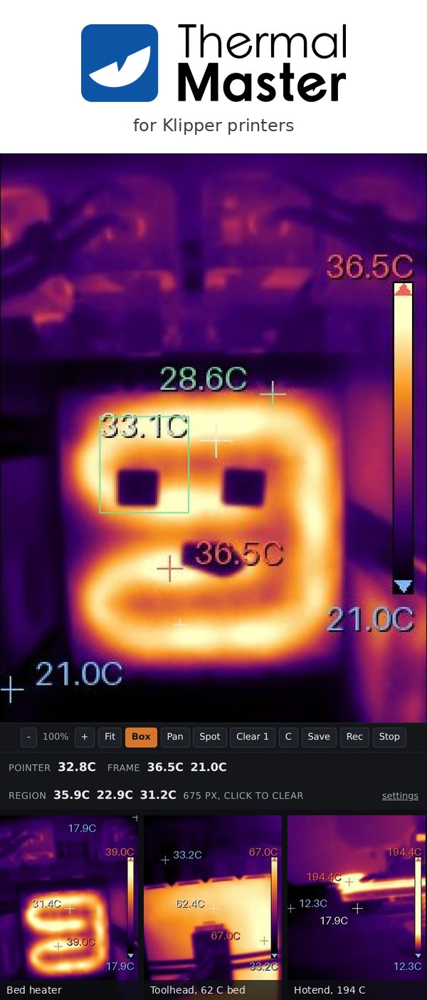

# thermal-master



The Bespok3d Thermal Master plugin for the Snapmaker U1: it streams a Thermal Master **P1 or P3**
USB thermal camera, so you can watch a print thermally in Fluidd or Mainsail with no UVC, no
firmware flashing, and no Rockchip MPP dependency. Plug either one in; the plugin tells them apart
by their USB product ID and drives both from the same code path. It also runs on other Klipper
printers, started by hand until Bespok3d supports them (see [hardware status](#hardware-status)).

- **A live thermal camera** in the Fluidd or Mainsail dashboard, with the hottest and coldest
  pixels marked and a temperature ruler.
- **An interactive viewer** at `/thermal/view`: read the temperature under the pointer, measure a
  region, place spot markers, zoom, save a still or record a clip, and hold the colour range so a
  colour means the same temperature in every frame.
- **Six palettes and four colour scales**, from an even stretch to a knee that keeps a hot nozzle
  visible without losing the part.
- **A thermal timelapse of every print**, one frame per layer, made into a clip on the printer and
  copied to the Timelapse page of Fluidd and Mainsail.

The plugin's own documentation, [`plugin/doc/README.md`](plugin/doc/README.md), shows the palettes
and scales and lists every setting.

### How it works

Neither camera is a UVC device. They speak a vendor protocol over raw USB, so the kernel never
creates a video device for them. The plugin drives the camera directly over libusb, turns its 16-bit
temperature frame into a colour image with the readout drawn in, and serves it as ordinary MJPEG.
The whole capture path is pure Python, with no arm64 build toolchain. It is also a worked example
of a camera plugin that does not use V4L2; for the concepts, see the Bespok3d docs
`doc/anatomy-of-a-plugin.md` and `doc/package-format.md`.

### What it costs the printer

Measured on both printers with `scripts/measure-cpu-on-printer.sh`, as a share of one core:

| State | Snapmaker U1 (Cortex-A53) | Raspberry Pi 4 (Cortex-A72) |
| --- | --- | --- |
| Camera switched off | 0.0% | 0.1% |
| Nothing watching | 4.6% | 4.1% |
| A dashboard tile visible | 41.9% | 37.5% |
| The viewer open, pointer moving | 45.7% | 36.4% |

It was 62.5% before the rendering pipeline was profiled, and 40.6% at rest before the plugin
learned to stop working when nobody is looking; ROADMAP sections 5 and 7g tell how it got here. The
settings page shows the plugin's own share live.

## Sponsorship

Thermal Master supports this project with hardware and an affiliate arrangement. It does not fund
it, and it does not buy any of the technical content: the figures above are measurements from a
printer, the [hardware status](#hardware-status) says plainly that the P3 has not been tested, and
anything that stops being true about either camera gets written here whatever the arrangement is.

### Where to buy a P1

If you are buying one and want the project to benefit, buy it through the shop link below. It costs
you nothing extra, and the discount code applies there.

| | |
| --- | --- |
| Official shop | https://thermalmaster.com/BESPOKD |
| Discount code | `THERMALYML01`, at that shop |

Before buying a P3, read the [hardware status](#hardware-status) below.

Disclosure: the shop link is an affiliate link, so the project earns a commission on purchases made
through it, at no extra cost to you.

## Hardware status

**P1 on a Snapmaker U1:** in daily use since 0.2.2, installed through Bespok3d. Every release since
then has been confirmed on the maintainer's printer, and the figures above come from it. The camera
tile works in Fluidd and Mainsail, the viewer and the settings page work in a dashboard tile,
settings survive a restart, and unplugging and replugging the camera recovers on its own.

**P1 on another Klipper printer:** an Ender 2 Pro on mainline Klipper, driven by a Raspberry Pi 4
with Debian 12, since 2026-09-29. Bespok3d does not support that printer yet, so the plugin was
started by hand, from the same wheels the U1 package ships. The camera, the viewer and the
timelapse work, and a replug recovers. ROADMAP section 9 has the details.

**P3:** driven by the same code, protocol and driver configuration, and not yet tested on a
printer. Its 256x192 sensor size is read from the driver rather than assumed. If you have a P3, it
should work, and a report either way is welcome.

## Layout

```text
plugin/
  manifest.json          metadata + install directives (single source of truth)
  requirements.txt       the three runtime dependencies, pinned
  files/bin/             thermal-master-stream.py: the service entry point, and nothing else
  files/lib/             thermal_master/: the plugin itself, as an importable package
  files/etc/nginx/       the reverse proxy that publishes the plugin under /thermal/
  files/vendor/          p3_camera.py, the vendored USB protocol driver (VENDORING.md)
  files/wheels/          BAKE OUTPUT, gitignored: the arm64 wheels the daemon installs
  files/webcam.conf.tmpl the [webcam] fragment that registers the camera with Moonraker
  doc/                   the documentation shown in the app, plus the changelog
  tests/                 the test suite, run against a stand-in camera rather than hardware
  tests/run.sh           the tests as CI runs them, without the gate's private submodule
scripts/
  check.sh               the gate: pytest, ruff, mypy, and the repo's own rules
  check-in-browser.py    drives both pages in a real browser; not in the gate, needs playwright
  fetch-vendor.sh        verify the vendored driver still matches its pin, in both directions
  measure-cpu-on-printer.sh   what the plugin costs, read from the kernel over ssh
  profile-on-printer.sh       where the time inside a frame goes, measured on the printer
  refresh-facade.py      keep the package facade in step with what the modules export
  tag_version_guard.sh   refuse a release tag whose version the manifest does not declare
  bench-*.py, compare-rendering.py, profile-frame-cost.py
                         one-off measurements behind decisions in the roadmap
.github/workflows/tests.yml     CI on every pull request and branch push: the tests, no secrets
.github/workflows/release.yml   CI on a release tag: bake, test, pack, sign, release, register
```

The entry script only sets a path and calls `main`. `thermal-master-stream` is a valid program name
but not a valid module name, so the code lives in `files/lib/thermal_master/`, where it can be
imported, tested and type checked like any other package (ROADMAP F-47).

## Vendored upstream

The USB protocol layer is **not** reimplemented here. `plugin/files/vendor/p3_camera.py` is checked
in verbatim at a pinned commit from
[jvdillon/p3-ir-camera](https://github.com/jvdillon/p3-ir-camera) (Apache-2.0), with its sha256 and
the update procedure in [VENDORING.md](VENDORING.md). Protocol reverse-engineering credit:
@aeternium. See `NOTICE`. What this repo adds is the rendering, the temperature readout, the two
pages, the timelapse and the service around them.

The driver is not ours to edit, so where it is wrong for a P1 the plugin works around it: its
`trigger_shutter` reads back a frame at offsets measured on a P3, which run past the end of a P1's
smaller frame, so the plugin sends the calibration command itself. That is reported upstream.

`numpy`, `Pillow` and `pyusb` are pinned in `plugin/requirements.txt`. The build downloads them as
arm64 wheels, and the daemon installs them into a virtual environment belonging to this plugin
alone, so nothing lands in the shared daemon venv. `pyusb` needs `libusb-1.0.so.0`, which the U1
has.

## Build locally

Requires Node.js 20+. Install the builder into its own prefix, never through `npx`, which can run a
stale cached copy against an out of date manifest schema:

```sh
npm install --prefix ~/.b3-builder github:Bespok3d/b3-builder
~/.b3-builder/node_modules/.bin/b3-builder build \
  --source ./plugin --out dist --atom-repo Bespok3d/B3_ThermalMaster --bake
```

`--bake` downloads the arm64 wheels into `plugin/files/wheels/`, and is required: the builder
refuses to pack a plugin that declares Python dependencies with no wheels.

To check the vendored driver still matches its pin:

```sh
sh scripts/fetch-vendor.sh
```

## The gate

`scripts/check.sh` has to pass before anything is committed: pytest, ruff, mypy, shellcheck, and
the repo's own rules about release triggers, manifest origin, workflow pinning and dashes. Part of
it lives in the `lib_bespok3d` submodule:

```sh
git submodule sync --recursive && git submodule update --init --recursive
bash scripts/check.sh
```

`lib_bespok3d` is private to the Bespok3d organisation, so a clone from outside it has no gate.
`sh plugin/tests/run.sh` runs the test suite on its own, which is what CI runs on every pull
request.

The pages are the part the test suite cannot really exercise. After touching either one:

```sh
pip install playwright && playwright install chromium
python3 scripts/check-in-browser.py
```

## Releasing

A release is published by a version tag and by nothing else.

1. Bump `version` in `plugin/manifest.json` and set `updated_at` to the release date (the builder
   does not stamp it; `published_at` stays at the first release's). Add the entry to
   `plugin/doc/CHANGELOG.md`.
2. Open a pull request to `main`. It can only merge once the `tests` check passes.
3. Tag `main` with `plugin-thermal-master-v<version>` and push that one tag.

`scripts/tag_version_guard.sh` refuses a tag whose version the manifest does not declare, and
anything that is not a release tag, so a branch can never publish. CI then bakes the wheels, runs
the tests, packs and signs the `.b3`, publishes a GitHub release, and registers it in the
organisation's index.

**Signing.** Packages are signed with the Bespok3d organisation's key, whose fingerprint replaces
`"publisher": "PLACEHOLDER"` in the packed manifest. The key and the index token are organisation
secrets, `REGISTRY_SIGNING_KEY` and `MAIN_INDEX_TOKEN`, read by name and never written into a file
here; neither is needed to build locally. Only maintainers can push a `plugin-*` tag, because a tag
publishes a package carrying the organisation's signature.
